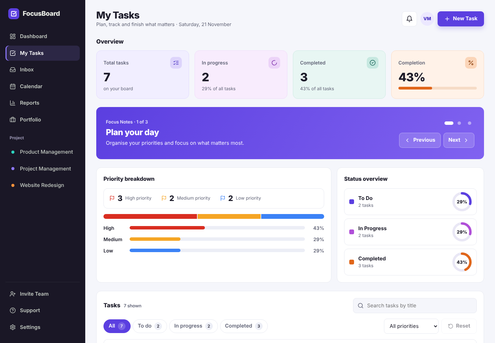
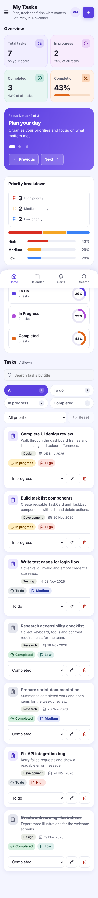

# FocusBoard

A responsive, single-user task dashboard built for the FocusBoard frontend assessment. Create, edit, delete and filter tasks, track progress with live statistics, and flip through the Focus Notes carousel. Everything runs in the browser and is saved to `localStorage`.

- **Live app:** `https://<your-app>.vercel.app` _(add after deploying)_
- **GitHub:** `https://github.com/<your-username>/focusboard` _(add after pushing)_

## Tech stack

React 18 · Vite 5 · JavaScript (ES6+) · plain CSS (custom properties, media queries) · Lucide React icons · localStorage · no backend.

## Features

| Area          | What is implemented                                                                                                                                                                          |
| ------------- | -------------------------------------------------------------------------------------------------------------------------------------------------------------------------------------------- |
| Tasks         | Create, edit (same form), delete with confirmation dialog, inline status change                                                                                                              |
| Sample data   | 7 seeded tasks with unique id, title, description, category, status, priority, due date                                                                                                      |
| Statistics    | Total, in progress, completed and completion % — all derived from state (zero-task safe)                                                                                                     |
| Search        | Case-insensitive, partial-match title search with clear button and empty state                                                                                                               |
| Filters       | Status tabs (with counts), priority dropdown, reset; all combine with search                                                                                                                 |
| Popups        | Toast messages for "Task created / updated / deleted" and for placeholder navigation                                                                                                         |
| Charts        | Priority breakdown (counts, stacked bar, progress bars) and status overview (donut rings), drawn with SVG/CSS from task state                                                                |
| Focus Notes   | 3 slides, Previous/Next (circular), clickable indicators, arrow-key support, live region                                                                                                     |
| Persistence   | `focusboard_tasks` in localStorage; sample data only loads when nothing valid is saved                                                                                                       |
| Responsive    | Checked at 390, 768 and 1440 px; sidebar becomes a drawer below 1100 px; no horizontal overflow                                                                                              |
| Accessibility | Semantic landmarks, labelled fields, skip link, visible focus, focus-trapped dialogs with Esc, status never shown by colour alone (icon + text), 44 px touch targets, reduced-motion support |

## Run locally

```bash
npm install
npm run dev        # http://localhost:5173
npm run build      # production build in dist/
npm run preview    # serve the build
```

## Folder structure

```
src/
  components/  Sidebar, Header, StatCard, FocusNotes, SearchBar, FilterTabs,
               TaskList, TaskCard, TaskForm, Modal, ConfirmDialog
  data/        sampleTasks.js (seed data + status/priority/category constants)
  hooks/       useLocalStorage.js
  utils/       helpers.js (stats, date formatting, id creation, validation)
  App.jsx      state + composition
  index.css    design tokens and all styles
```

## State management choice

I used **React hooks only** (`useState`, `useMemo`, a custom `useLocalStorage` hook) with state held in `App.jsx` and passed down as props. The app has one data entity and a shallow component tree, so Context, Redux or Zustand would add code without solving a real problem.

- **Single source of truth:** one `tasks` array in `App`. Cards, rows, statistics, filters and the form all read from it.
- **Predictable mutations:** add, edit, status change and delete use functional updates (`setTasks(prev => ...)` with `map`/`filter`/spread), so existing state is never mutated. Edit keeps the original `id`.
- **Derived values:** `stats`, `visibleTasks` and the tab counts are computed with `useMemo` from `tasks`, `search`, `statusFilter` and `priorityFilter`. They are never stored, so they cannot go stale.
- **UI state:** search text, filters, which task is being edited/deleted, drawer open state — kept separately from task data.
- **Carousel:** `FocusNotes` owns an `index` state; the visible slide, "n of 3" label and active dot are all computed from it. Navigation wraps around.

## localStorage

`useLocalStorage(key, initialValue, validate)` reads once via a lazy `useState` initialiser and writes in a `useEffect` whenever the value changes. If the key is missing, the JSON is corrupt, the shape fails `isValidTaskList`, or storage is blocked, it falls back to the sample tasks. Because the sample data is only an initial value, a refresh never overwrites saved work. The full task list is saved; filters and search are not persisted.

## Testing

Manually and with an automated browser script, I checked: seeded data, create with validation (empty, spaces-only, missing date), trimmed titles, edit without duplicates, delete cancel/confirm, status changes updating the stats, search + status + priority together, empty states, persistence across refresh, corrupt storage fallback, zero tasks, carousel wrap-around and indicators, and no horizontal overflow at 390 / 768 / 1440 px.

## Screenshots

| Desktop (1440)                      | Mobile (390)                      |
| ----------------------------------- | --------------------------------- |
|  |  |

Tablet (768): `screenshots/tablet.png` · Create-task form: `screenshots/form-desktop.png`, `screenshots/form-mobile.png`

## Limitations and pending work

- **Figma fidelity:** styled to the three supplied reference images (dark sidebar with sections and pastel stat cards for desktop, purple carousel cards and bottom tab bar for mobile, grey-filled form fields for create-task). The exact Figma frames were not accessible, so final spacing, colours and the Focus Notes slide copy should be checked against them. Colours are CSS variables at the top of `src/index.css` (`--brand` is the main accent); slide text is the `SLIDES` array in `FocusNotes.jsx`.
- Sidebar items (except Dashboard and My Tasks, which scroll to their sections), project list, bottom-bar Calendar/Alerts and the notification bell are visual placeholders that show a "coming soon" popup (no extra screens, per the brief).
- Filters and search reset on refresh (only tasks are persisted).
- Data is per browser; there is no sync or multi-user support.
